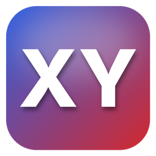
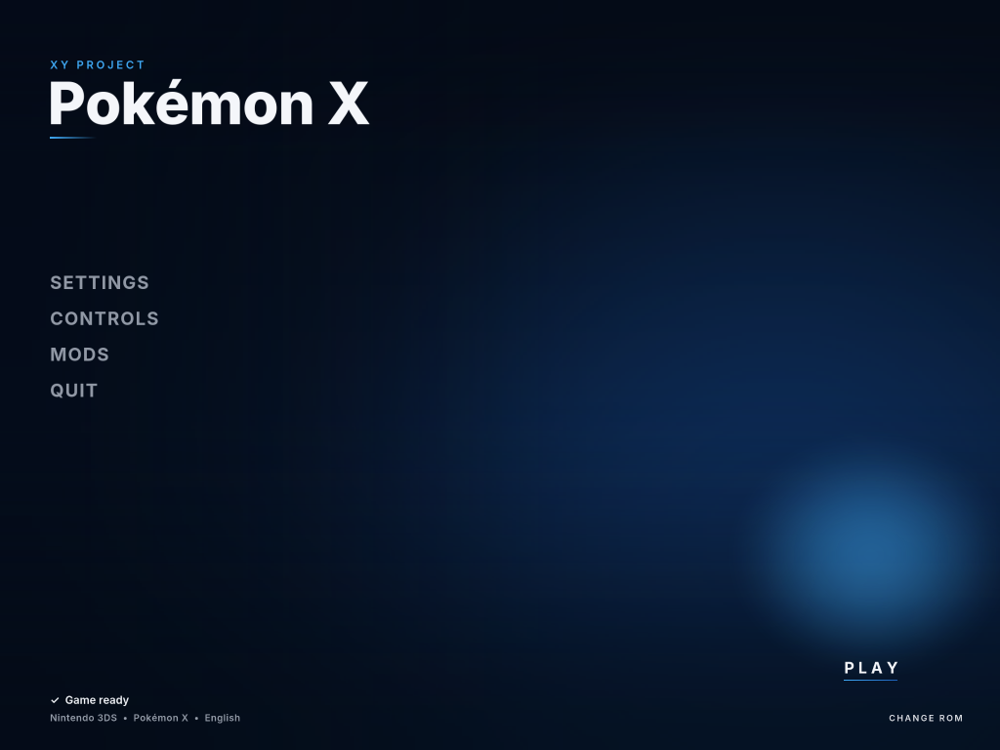
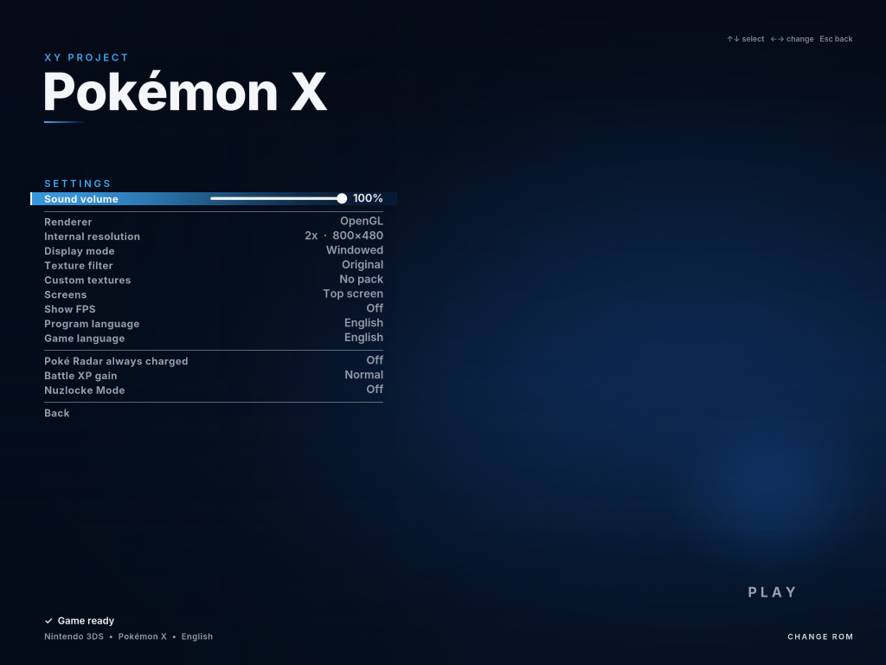
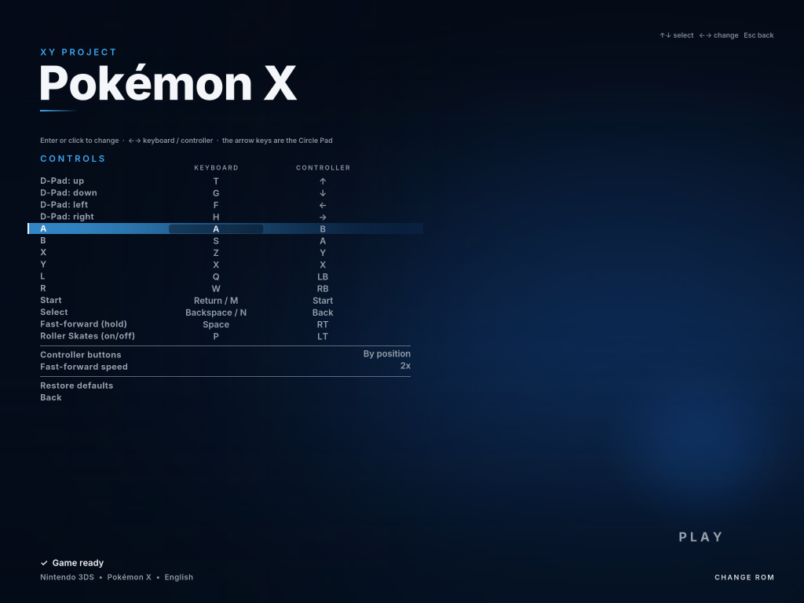

<p align="center">
  
</p>

<h1 align="center">XY Project</h1>

<p align="center">
  <b>A native PC port of Pokémon X and Pokémon Y (Nintendo 3DS), built by static recompilation.</b><br>
  Windows · Linux · OpenGL 3.3 · Vulkan 1.3 · up to 4K<br>
  Created by <a href="https://github.com/pedroedilbertocruz-maker"><b>Kimiroto</b></a>
</p>

<p align="center">
  <a href="../../releases/latest">Download</a> ·
  <a href="#getting-started">Getting started</a> ·
  <a href="#features">Features</a> ·
  <a href="#how-it-works">How it works</a> ·
  <a href="#credits-and-sources">Credits</a> ·
  <a href="MANUAL.md">Full manual (PT · EN · ES · JA)</a>
</p>

---

> **No game files are included.** This project contains only tools and a runtime. It reads **your own
> decrypted dump** of a cartridge you own, translates the game's code to C on your machine, and compiles it there.
> Never share ROMs, the generated code (`jogos/`), or anything extracted from the game.

## What is this?

XY Project takes the ARM11 machine code of Pokémon X / Pokémon Y and converts it, once, into **native C code**
that is compiled and run on the PC, with no CPU emulator. The roughly 76,000 functions of the game become ordinary
compiled functions.

Around that code, the project provides what the game expects to find on a 3DS:

* a **high-level reimplementation of the 3DS operating system** (threads, events, timers, and services such as
  file system, saves, input, camera, microphone);
* a **PICA200 GPU front-end** that turns the game's GPU commands into **OpenGL 3.3** or **Vulkan 1.3**, which is
  what makes higher resolutions and custom textures possible;
* **audio** through a high-level DSP implementation (adapted from Azahar/Citra) plus AAC music via faad2.

It sits between an emulator and a true source port: the game logic runs natively, while graphics, audio and system
services go through translation layers.

## Screenshots

These show the project's own interface (the in-game menu over its default background).

| Main menu | Settings | Controls |
|---|---|---|
|  |  |  |

## Features

**Graphics**
* OpenGL 3.3 and Vulkan 1.3 renderers (Vulkan falls back to OpenGL automatically if unavailable).
* Internal resolution up to **4K** (1x–9x), for both screens.
* Texture filters: original, bilinear, 16x anisotropic, bicubic (Catmull-Rom) + anisotropic.
* **Custom texture packs** in the Citra/Azahar format (PNG, old hash), toggled live.
* Vulkan pipeline cache with automatic shader rebuild after a GPU driver update (with an on-screen notice).
* Layouts: full top screen (16:9) with the bottom screen on demand, or stacked screens; fullscreen.

**Controls**
* Keyboard (Citra/Azahar layout), mouse as the touch screen, Xbox / PlayStation / Switch controllers through SDL,
  generic DirectInput controllers with automatic mapping.
* **Full key and button remapping** in the in-game menu.
* Right stick drives a touch cursor on the bottom screen.

**Quality of life**
* **Fast-forward** (hold Space / RT; 2x, 3x or 4x): the whole game, including its clock, runs faster.
* **Roller Skates toggle** (P / LT): walk with the analog stick instead of skating.
* **Screenshots** (F12) at the internal resolution, saved as PNG.
* **FPS counter**, volume slider, animated menu background (with your own art, optional).
* **Automatic save backup** every time the game opens (last 5 kept).
* **Crash reports**: if the game closes with an error, a report with the error type, location, game thread and
  registers, loaded modules and the end of the log is saved and can be opened from the launcher.
* Program language: **Português, English, Español, 日本語** (separate from the game's language).

**Game options**
* Poké Radar always charged, battle XP multiplier, Nuzlocke mode, mod folders.

**Launcher (Windows)**
* `XY Project.exe`: choose the ROM, resolution, filter, renderer and language, then PLAY. The first run downloads
  the toolchain into a local folder, recompiles the game and builds it, showing progress.

## Getting started

### Requirements

* A **decrypted** `.3ds` dump of **Pokémon X** or **Pokémon Y** from your own cartridge.
* About **3 GB** of free disk space (generated and compiled code).
* A GPU with OpenGL 3.3 (or Vulkan 1.3 for the Vulkan renderer).
* First build: 10–40 minutes depending on the CPU. After that the game opens immediately.

### Windows

1. Download `XY-Project-1.0-Windows.zip` from the [latest release](../../releases/latest) and unzip it to a folder
   with ~3 GB free.
2. Open **`XY Project.exe`**.
3. Pick your decrypted `.3ds` (or drag it onto the window), adjust the options, and click **PLAY**.

On the first run the launcher downloads, **only inside the project's `ferramentas` folder**, a portable Python
(python.org), the llvm-mingw compiler and SDL2 (GitHub), then recompiles and builds the game.

### Linux

1. Download `XY-Project-1.0-Linux.tar.gz` from the [latest release](../../releases/latest) and extract it.
2. Install the dependencies, for example on Debian/Ubuntu:
   ```sh
   sudo apt install python3 clang libsdl2-dev
   ```
3. Run:
   ```sh
   ./jogar.sh path/to/your/game.3ds
   ```

Without SDL2 the game still builds and runs, but with no window or sound (useful only for testing).

### Default controls

| 3DS | Keyboard | Controller |
|---|---|---|
| Circle Pad | Arrow keys | Left stick |
| D-Pad | T F G H | D-pad |
| A / B / X / Y | A / S / Z / X | Face buttons (3DS positions or labels) |
| L / R | Q / W | LB / RB |
| Start / Select | Enter / Backspace | Start / Back |
| Touch screen | Mouse on the bottom screen | Right stick cursor, R3 to touch |
| Show bottom screen | Tab | L3 |
| Fast-forward (hold) | Space | RT |
| Roller Skates on/off | P | LT |
| Screenshot | F12 | — |
| Texture filter / Resolution / Layout | F7 / F8 / F9 | — |
| Fullscreen | F11 | — |
| Game menu | Esc | Guide |

Everything except the system keys can be remapped in **Controls**.

### Where things are

| Path | What |
|---|---|
| `jogos/<title id>/save` | Your save |
| `jogos/<title id>/backups/` | Automatic save backups (zip) |
| `jogos/<title id>/erros/` | Crash reports |
| `jogos/<title id>/jogo.log` | Game log |
| `capturas/` | Screenshots |
| `texturas/<title id>/` | Custom texture packs (yours) |
| `fundos/fundo_x.jpg`, `fundo_y.jpg` | Optional menu background art (yours) |
| `icones/patins.png` | Optional Roller Skates icon (yours) |
| `opcoes.txt`, `lancador.ini` | Settings |

Folders marked "yours" are for your own files and are never part of the project. Don't include them, the ROM, or
`jogos/` when sharing.

## How it works

1. **Parsing**: `tools/ctr.py` reads the decrypted `.3ds` (ExeFS/RomFS); `tools/cro.py` reads the game's CRO/CRS
   dynamic modules (110 `.cro` files).
2. **Linking**: `tools/link.py` places `code.bin` at `0x00100000` and every CRO from `0x40000000` into a single
   image.
3. **Function discovery**: `tools/funcs.py` finds functions through BL/BLX targets, vtables, literal pools,
   relative tables, CRO exports, ARMv4-style calls, ADR and ARM/Thumb prologues.
4. **Recompilation**: `tools/recomp.py` translates each function (ARMv6K + VFPv2 + ARMv6 SIMD + Thumb-1) into a C
   function. Unknown indirect targets found at run time are fed back as seeds.
5. **Runtime** (`runtime/`): loader and indirect-call dispatch, HLE kernel (single-core scheduler with preemption,
   synchronization objects), services (`srv:`, APT, HID, CFG, FS, DSP, GSP, `ldr:ro`, Y2R, CAM, MIC…), the PICA200
   front-end (`pica*.c`, `pica_gl.c`, `pica_vk.c`), audio, input, menu and launcher UI.
6. **Build**: `tools/jogar.py` drives the whole pipeline, compiles in parallel, and launches the game.

The recompiler is covered by differential tests against a separate reference ARM interpreter (`tools/armi.py`,
`test/`). See [MANUAL.md](MANUAL.md) for the full development log, debugging tools and environment variables.

## Project status

Version **1.0**: the game is playable from the opening to the overworld, battles, menus, Pokémon-Amie, PSS menu
and saves, on Windows and Linux. Known limitations:

* Online features (GTS, Wonder Trade, battles/trades over the internet or local wireless) are not implemented.
* Camera and microphone are stubs (black image, silence).
* The game's own frame rate (30 fps) is kept; an experimental 60 fps interpolation exists but is disabled.
* Vulkan is newer than OpenGL; if you see a rendering issue, try OpenGL and report it.

When something breaks, the crash report in `jogos/<title id>/erros/` is the most useful thing to attach to an issue.

## Credits and sources

**XY Project was created by [Kimiroto](https://github.com/pedroedilbertocruz-maker).**

### Third-party code included

| Component | Use | License |
|---|---|---|
| [Azahar](https://github.com/azahar-emu/azahar) / [Citra](https://github.com/citra-emu/citra) audio core (`runtime/audio/`) | High-level DSP emulation (voices, mixing, filters, ADPCM/PCM) | GPL-2.0-or-later |
| [faad2](https://github.com/knik0/faad2) (`runtime/faad2/`) | AAC music decoding | GPL-2.0-or-later |
| [stb_image / stb_image_write](https://github.com/nothings/stb) | PNG/JPEG loading, PNG screenshots | Public domain / MIT |
| [CityHash](https://github.com/google/cityhash) (in `runtime/texpack.c`) | Texture hashes compatible with Citra packs | MIT |
| [Vulkan headers](https://github.com/KhronosGroup/Vulkan-Headers) (`runtime/vulkan/`) | Vulkan API | Apache-2.0 / MIT |

### Downloaded at first run (not redistributed here)

| Component | Use | License |
|---|---|---|
| [SDL2](https://github.com/libsdl-org/SDL) | Window, input, audio | zlib |
| [SDL_GameControllerDB](https://github.com/mdqinc/SDL_GameControllerDB) | Community controller mappings | zlib |
| [llvm-mingw](https://github.com/mstorsjo/llvm-mingw) | C/C++ compiler on Windows | Apache-2.0 with LLVM exceptions |
| [Python embeddable](https://www.python.org/downloads/windows/) | Build scripts on Windows | PSF |

### Fonts (rendered into bitmaps in `runtime/fonte_menu.h` and `runtime/fonte_aviso.h`)

| Font | Use | License |
|---|---|---|
| [Inter](https://github.com/rsms/inter) (Rasmus Andersson) | Menu and launcher text | SIL Open Font License 1.1 |
| [Noto Sans CJK JP](https://github.com/notofonts/noto-cjk) | Japanese text | SIL Open Font License 1.1 |
| [DejaVu Sans Bold](https://dejavu-fonts.github.io/) | On-screen notices | DejaVu Fonts License (Bitstream Vera derivative) |

### Documentation and references

* [3DBrew](https://www.3dbrew.org/) — the community wiki documenting the 3DS hardware, file formats (NCSD, NCCH,
  ExeFS, RomFS, CRO), system calls and services. Most of the HLE kernel and services follow it.
* [Azahar](https://github.com/azahar-emu/azahar) / [Citra](https://github.com/citra-emu/citra) — reference for
  service behavior and the PICA200 GPU, the custom texture pack format and hash, and the default keyboard layout.
* ARM Architecture Reference Manual (ARMv6, VFPv2, Thumb) — instruction semantics for the recompiler.

### Inspiration

* [N64Recomp](https://github.com/N64Recomp/N64Recomp) and
  [Zelda64Recomp](https://github.com/Zelda64Recomp/Zelda64Recomp) (Mr-Wiseguy and contributors) showed that
  static recompilation of a whole console game into a native PC port, with an HLE layer around it, is practical.
  XY Project applies the same idea to the 3DS.
* The Citra/Azahar projects, whose open work made understanding the 3DS possible at all.

## License

Copyright © 2026 Kimiroto.

The project's own code is released under the **GNU General Public License v2.0 or later** (see [LICENSE](LICENSE)),
because it includes GPL components (Azahar/Citra audio core, faad2). Third-party components keep their own licenses
listed above. None of this includes game data.

## Legal

XY Project is an unofficial fan project for preservation and personal use. It is **not affiliated with, endorsed
by, or sponsored by** Nintendo, Game Freak, Creatures Inc. or The Pokémon Company. Pokémon, Pokémon X and
Pokémon Y are trademarks of their respective owners. No copyrighted game assets, code or ROMs are distributed with
this project. You need your own legally obtained copy of the game.
